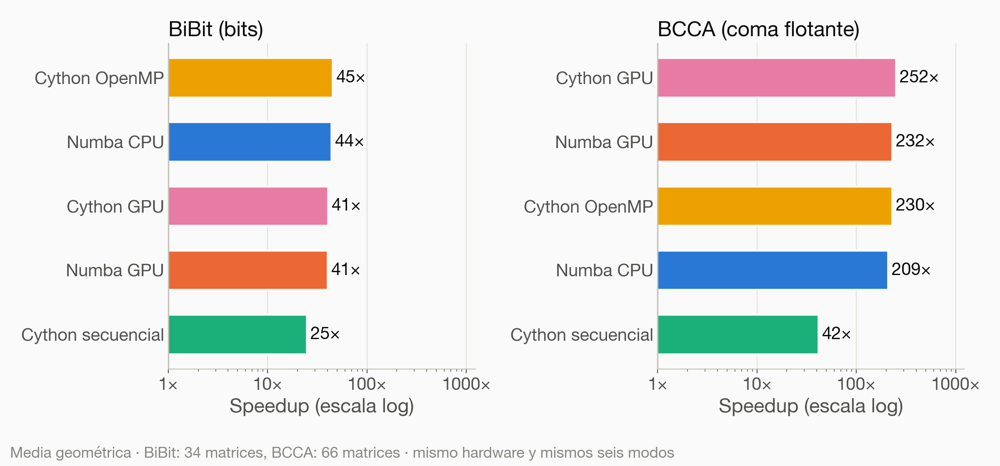
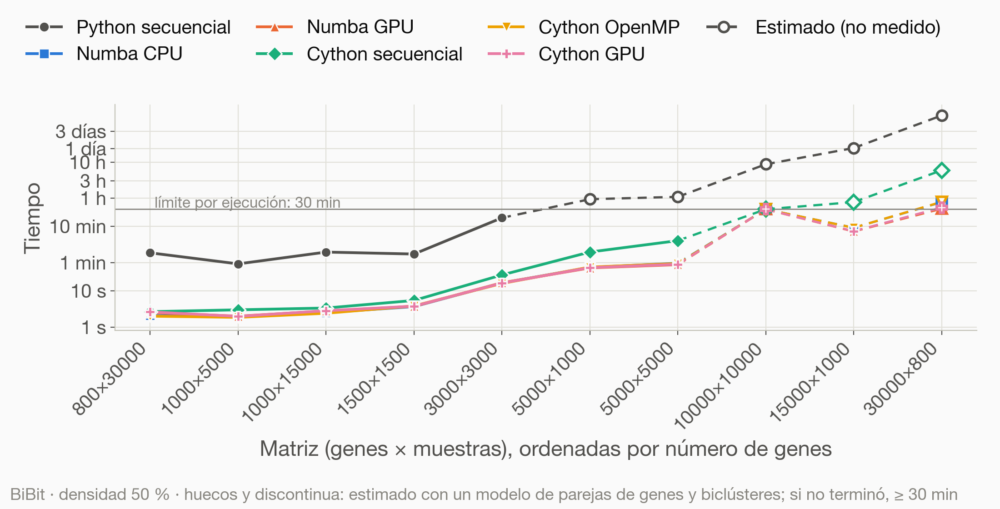
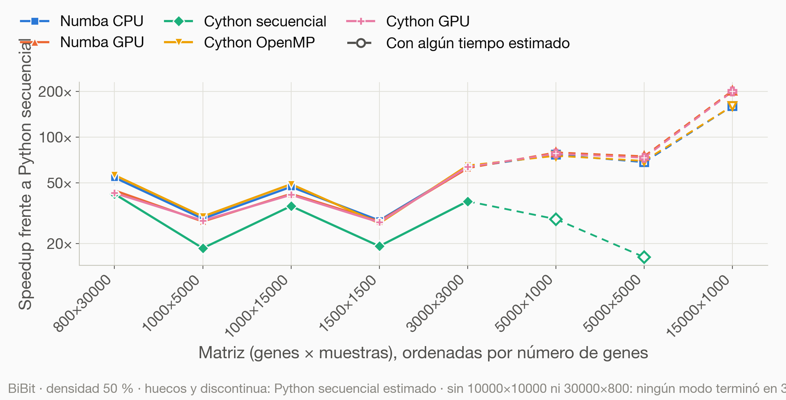
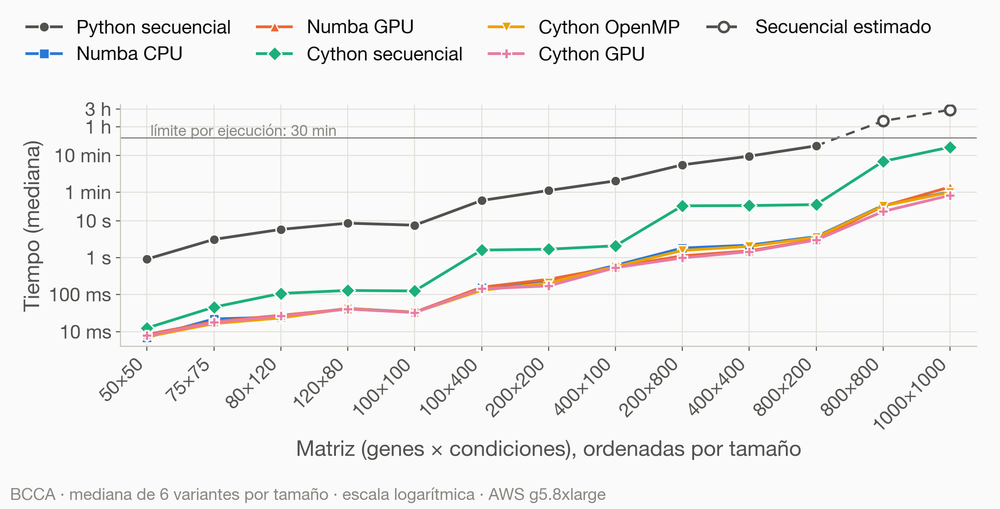
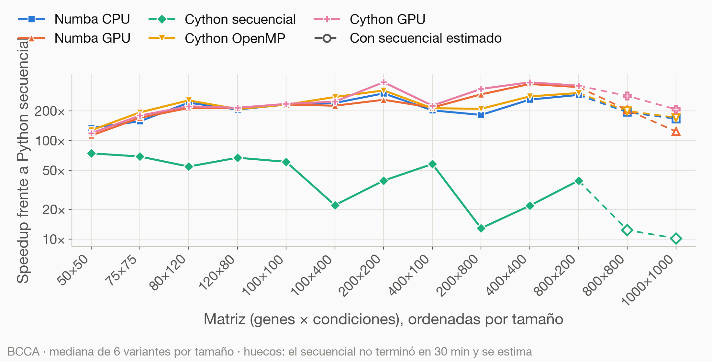

# Más allá del GIL: aceleración de algoritmos genómicos con Numba, Cython y CUDA

Material de la ponencia de **Pablo Oca Galeano** en la **PyCon España 2026** (Barcelona, 8 de noviembre de 2026).

📄 **[Diapositivas (PDF)](presentacion/presentacion.pdf)**  
📦 **Librería: [bioScience](https://github.com/aureliolfdez/bioscience)**, en la que se publicarán las seis implementaciones de BiBit y BCCA

¿Hasta dónde llega Python en problemas de alta intensidad computacional? La charla parte de dos algoritmos de *biclustering* sobre matrices de expresión génica, **BiBit** (matrices binarias) y **BCCA** (correlación sobre matrices continuas), y compara seis implementaciones de cada uno:

| Modo | Tecnología |
|---|---|
| Python secuencial | Python + NumPy (referencia) |
| Numba CPU | `@njit(parallel=True)` + `prange` |
| Numba GPU | `numba.cuda` |
| Cython secuencial | Cython compilado a C |
| Cython OpenMP | Cython + `prange` / OpenMP (sin GIL) |
| Cython GPU | Cython + kernels CUDA (`.cu`) |

## Resultados

Todas las medidas se hicieron con la librería [bioScience](https://github.com/aureliolfdez/bioscience). Todos los modos se ejecutaron en la misma máquina, sobre las mismas matrices sintéticas y con un límite de **30 minutos por ejecución**. El tiempo medido es solo el de la llamada al algoritmo: antes de cronometrar se hace un calentamiento para que la compilación JIT de Numba y la creación del contexto CUDA no cuenten.

**Máquina (AWS `g5.8xlarge`):** AMD EPYC 7R32 (32 vCPU), 124 GiB de RAM, NVIDIA A10G (24 GB) · Python 3.12.3, NumPy 2.5.4, Numba 0.68.0, Cython 3.3.0, CUDA 13.2.

### Speedup frente a Python secuencial

Media geométrica sobre las matrices en las que terminaron los seis modos (34 en BiBit y 66 en BCCA).

| Modo | BiBit | BCCA |
|---|---:|---:|
| Cython GPU | 41× | **252×** |
| Numba GPU | 41× | 232× |
| Cython OpenMP | **45×** | 230× |
| Numba CPU | 44× | 209× |
| Cython secuencial | 25× | 42× |



### BiBit

360 ejecuciones: 280 medidas, 13 superaron el límite de 30 min (TIMEOUT) y 67 no se lanzaron porque una matriz más pequeña ya lo había superado en ese modo (OMITIDO).




Tiempo mediano en segundos:

| Matriz | Python sec. | Numba CPU | Numba GPU | Cython sec. | Cython OpenMP | Cython GPU |
|---|---:|---:|---:|---:|---:|---:|
| 1500×1500 | 104 | 3,65 | 3,74 | 5,36 | 3,78 | 3,79 |
| 3000×3000 | 1040 | 17 | 17 | 27 | 16 | 16 |
| 5000×1000 | 779 | 45 | 43 | 117 | 45 | 44 |
| 15000×1000 | — | 520 | 439 | 784 | 515 | 448 |
| 30000×800 | 466 | 2,40 | 1,91 | 22 | 2,42 | 1,96 |
| 5000×5000 | — | 58 | 53 | 246 | 57 | 54 |

### BCCA

468 ejecuciones: 456 medidas, 1 TIMEOUT y 11 OMITIDO.




Tiempo mediano en segundos:

| Matriz | Python sec. | Numba CPU | Numba GPU | Cython sec. | Cython OpenMP | Cython GPU |
|---|---:|---:|---:|---:|---:|---:|
| 200×200 | 67 | 0,23 | 0,26 | 1,72 | 0,21 | 0,17 |
| 400×400 | 575 | 2,21 | 1,55 | 26 | 2,06 | 1,48 |
| 800×200 | 1097 | 3,77 | 3,14 | 28 | 3,61 | 3,05 |
| 800×800 | — | 27 | 25 | 415 | 26 | 18 |
| 1000×1000 | — | 62 | 84 | 1013 | 60 | 50 |

«—» = no terminó en 30 min. En las gráficas, esos casos aparecen como estimación (marcadores huecos y línea discontinua).

Los datos completos están en [`benchmark/resultados/`](benchmark/resultados): un CSV por algoritmo con cada ejecución, los logs y el entorno de la máquina.

## Estructura del repositorio

```
presentacion/            Diapositivas: PDF y fuente LaTeX (Beamer, tema metropolis) con sus figuras
benchmark/               Script del benchmark, generadores de matrices y resultados
generacion_resultados/   Script que genera las gráficas de resultados de la ponencia
graficos_complejidad/    Script de las gráficas de complejidad teórica
```

## Reproducir

Las implementaciones de BiBit y BCCA (Numba, Cython y CUDA) se publicarán como parte de la librería
[bioScience](https://github.com/aureliolfdez/bioscience); todavía no están disponibles. Cuando lo estén,
el benchmark se puede repetir así:

```bash
# 1. Instalar las dependencias (y la versión de bioScience con los seis modos)
pip install -r benchmark/requirements_aws.txt

# 2. Generar las matrices sintéticas y lanzar el benchmark
cd benchmark
python generar_matrices_bibit.py
python generar_matrices_bcca.py
python run_benchmark.py bibit --smoke            # prueba rápida
python run_benchmark.py bibit --limite-horas 0.5
python run_benchmark.py bcca  --limite-horas 0.5
python estimar_tiempos.py bcca
```

Las gráficas y las diapositivas sí se pueden regenerar ya con los resultados incluidos:

```bash
cd generacion_resultados && python graficos_ponencia.py   # lee benchmark/resultados, escribe en presentacion/figuras/resultados
cd ../presentacion && latexmk -pdf presentacion.tex
```

Parámetros usados: BiBit `cMnr=2`, `cMnc=160`; BCCA umbral 0,7 y `minCols=3`.
